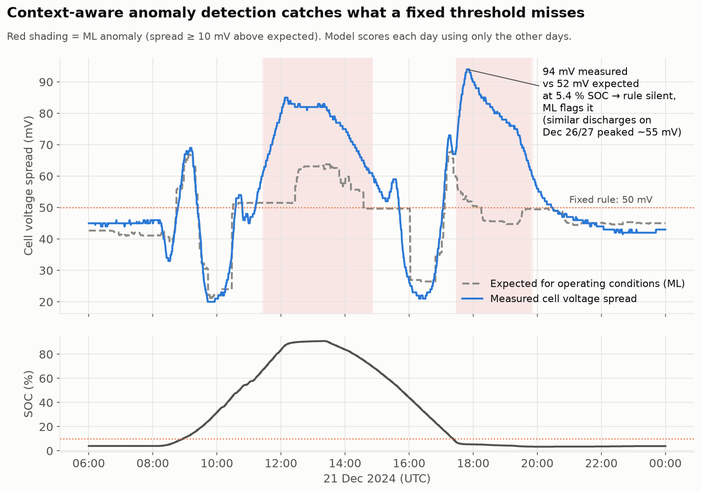
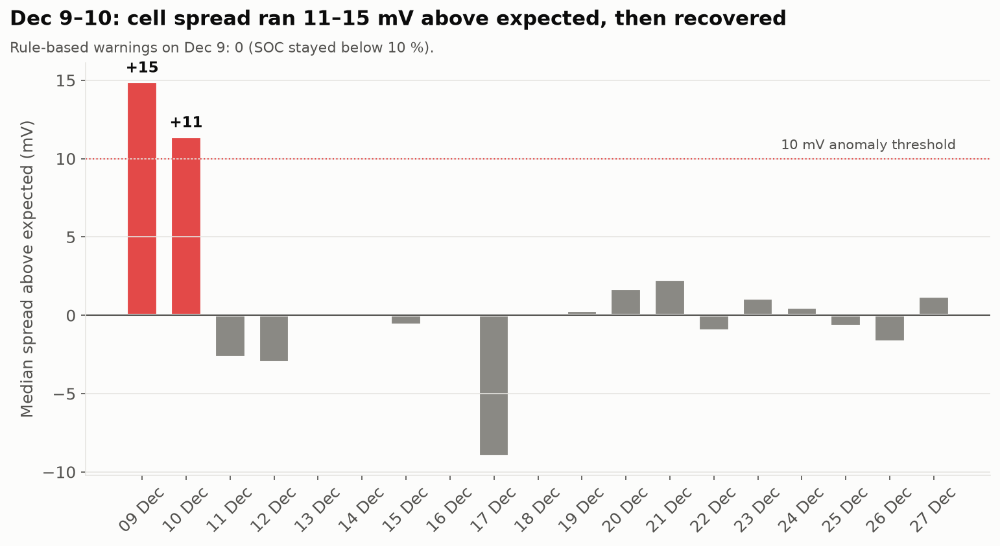

# 🔋 BESS Fault Detection and Operational Analysis

Python analysis of Battery Energy Storage System (BESS) time-series data: rule-based fault detection (v1) and context-aware ML anomaly detection (v2).



---

## 📁 Project Structure

```
BESS-Data-Analysis/
├── README.md
├── requirements.txt
├── Bess data task 1.csv          # BMU / SBMU currents and limits
├── BESS_data_task2.csv           # rack SOC, current, temperature, cell voltages (78k rows, 9–27 Dec 2024)
├── BESS_Data_Analysis.ipynb      # v1: rule-based analysis
└── anomaly_detection/            # v2: ML anomaly detection
    ├── detect.py
    ├── charts.py
    └── outputs/                  # events, daily summary, charts
```

---

## v2: Context-aware ML anomaly detection

### The problem with a fixed threshold
The v1 rule raises a warning when **SOC ≥ 10 % and cell voltage spread ≥ 50 mV**. But cell spread naturally depends on operating conditions: it is higher at the ends of the SOC window and under load. A fixed threshold therefore:
- warns about spread that is **normal for the conditions** (e.g. high SOC during charging), and
- is **blind below 10 % SOC**, where this rack spends most of its time.

### Approach
1. **Learn the expected spread** for each operating condition with a gradient-boosting model (features: SOC, current, 30-min mean |current|, max temperature; robust L1 loss).
2. **Leave-one-day-out validation:** every day is scored by a model trained only on the *other* days, so an abnormal day can't learn itself as normal.
3. **Flag excess spread:** measured − expected ≥ max(4 × robust σ, 10 mV), grouped into events (≥ 3 samples, gaps < 5 min).

### Results (78,424 samples, 9–27 Dec 2024)

| Metric | Value |
|---|---|
| Model error, mean / median | 4.1 mV / 1.4 mV |
| Naive baseline (median per SOC bin × state) | 5.5 mV |
| Rule warnings that ML considers normal for the conditions | 63 % |
| ML-flagged samples the rule missed | 5,713 (4,732 of them at SOC < 10 %) |

**Key findings**
- **Dec 21, 17:30–20:00:** after the only full 90 % → 5 % cycle, spread peaked at **94 mV vs 52 mV expected** and relaxed slowly. Comparable discharges to ~3.5 % SOC on Dec 26/27 peaked at ~55 mV. **The rule did not fire because SOC was below 10 %.** One possible explanation is cell capacity mismatch revealed at low SOC; this needs confirmation with cell-level data.
- **Dec 9–10:** spread ran **11–15 mV above expected** (median) for much of both days, then returned to normal from Dec 11 onward. The rule raised **zero** warnings on Dec 9.



### Limitations
- 19 days of data from one rack; high-SOC operation (> 60 %) appears on only 2 days, so expectations there are less certain.
- Rack-level min/max only: cannot identify *which* cell drives the spread.
- Flags are candidates for review, not confirmed faults.

### Run
```bash
pip install -r requirements.txt
python anomaly_detection/detect.py    # scores data, writes events and summaries to anomaly_detection/outputs/
python anomaly_detection/charts.py    # renders the charts
```

---

## v1: Rule-based analysis (notebook)

### Task 1: Operational fault detection (`Bess data task 1.csv`)
- Flat SOC periods during active current flow
- SBMU current limit violations (especially SBMU5, SBMU7, SBMU11, SBMU12)
- Imbalance between BMU1 current and total SBMU current

### Task 2: Warning analysis (`BESS_data_task2.csv`)
- Warning condition: SOC ≥ 10 % and voltage deviation ≥ 50 mV
- Warnings mostly in the 10–30 % SOC range
- Weak linear correlation between voltage deviation and temperature/current

### Run
```bash
git clone https://github.com/RameshNandiwale/BESS-Data-Analysis.git
cd BESS-Data-Analysis
pip install -r requirements.txt
jupyter notebook BESS_Data_Analysis.ipynb
```

---

## Tools
Python · pandas · NumPy · scikit-learn · Matplotlib · Seaborn · Jupyter
